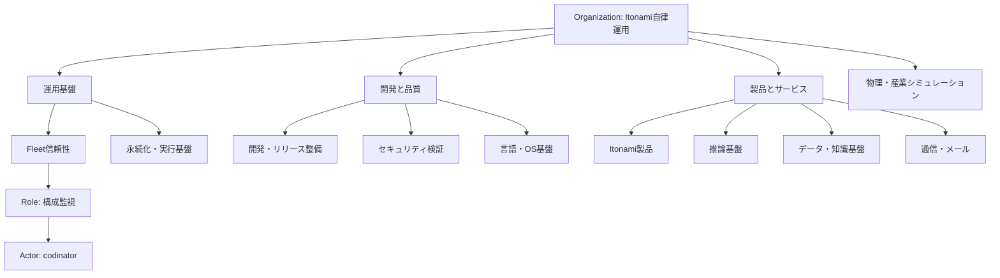

# Soshiki Circle情報設計 — 目的・責任・Bot運用をつなぐ

Status: **Draft / owner review pending / not applied**。2026-11-13、追跡 [AWAI-2808](https://linear.app/kotobalabs/issue/AWAI-2808)、親 [AWAI-2795](https://linear.app/kotobalabs/issue/AWAI-2795)。設計の保存であり、実Botの移動・起動・権限変更・Linear Cycle変更は行っていない。

## 1. 設計判断

**リポジトリ分類の上に、目的と責任で定義するCircleを設ける。BotはActorとしてRoleを担当する。** 同じBotが複数Roleを担っても、Actor・実行・tokenは二重計上しない。

既存の`repo:*`は技術的な登録・出典として保持する。761件を一括で正式な自治Circleに昇格させない。現在のブラウザー内「Itonami運用 > Fleet監視」の表示編集も保存したまま、正式Circleとの対応を別途レビューする。

HolaspiritではCircleはRoleが複数の役割に展開したチームで、目的・責任を持つ階層として扱われる。Roleと、それを担当するMemberの割当は分離されている。Soshikiにもこの分離を採用する。参照: [Governance Overview](https://help.holaspirit.com/en/article/governance-overview-vpg61/)、[Role Overview](https://help.holaspirit.com/en/article/role-overview-m6cn0z/)。

ただし、人の組織におけるDomainの所有をBotの実行許可に変換しない。Circle所属、Role割当、Domain、組織の承認は、runtime grantやブラウザーの個別操作承認を自動的には増やさない。

## 2. 現在の観測と読み方

固定したfleet artifactは2026-11-13 **16:27:13 JST**の観測。source revision、catalog/bytes SHAは同伴JSONに保存した。

| 観測対象 | 件数 | 意味 |
|---|---:|---|
| 登録Bot | 899 | 同一Actorを集計の基礎にする |
| repository Circle | 761 | 正本catalogの出典分類 |
| 1 Botだけのrepository Circle | 735 | 各々を自治組織にすると管理負担が大きい |
| 複数Botのrepository Circle | 26 | 既存の協働候補を探す入口 |
| 設定済みBot / held | 589 / 310 | 設定と未有効。業務成功率ではない |
| Project対応あり | 890 | 既存projectionの`linearBound`はこの対応状態を数える |
| Issue key選択あり | 845 | Project対応数とは異なる。異なるIssueは742件 |
| 正本Circleとcurrent App名の差分 | 36 | repo改名・移管があり、名前だけでIDを統合しない |

`physai-*`は登録683 Bot。そのうち共通physics rolloutの分類があるのは643、ないものは40。683件中582設定・101 heldであり、以前の「643共通判定対象 / 61 held」と混同しない。

候補割当は名前・担当repo・現在のIssue/予定から作った**提案**。全profileの目的や業務成果を実査して承認済みという意味ではない。既存Actorを削除せず、分類保留118 Botも台帳に残す。

## 3. Circle化する候補

初期候補10件は一次所属が重複しない。781 Botを提案に対応付け、118 Botは配置確認として残した。これは組織設計の網羅数で、稼働化・業務完成の件数ではない。

| 候補Circle | Bot / 設定 / held | まとめる理由・最初の責任分割 |
|---|---:|---|
| **Fleet信頼性** | **9 / 2 / 7** | 構成監視、cron/復旧監督、モデル・権限整合、容量と改善。最初のpilotに向く |
| **開発・リリース整備** | **13 / 1 / 12** | `pr-cleanup`、`reviewer`、`git-cleanup-ops`、`docs-audit`、`rule-kaizen`等の受け渡しを明示 |
| **Itonami製品** | **19 / 1 / 18** | `itonami-po`、`itonami-eng`、`itonami-qa`、`itonami-publish-gate`、support等を同じ製品成果につなぐ |
| **推論基盤** | **9 / 0 / 9** | `murakumo`、`mishima-fast`、`murakumo-tok`、`murakumo-infer-maturity`、`web-plane`等。現在heldのまま役割を定義 |
| 永続化・実行基盤 | 4 / 0 / 4 | `yataverse-storage-research`、`tee-guest-maint`、`compute-energy-watch`、`kotobase-b2`。保存・VM・資源の検証を統合 |
| セキュリティ検証 | 5 / 1 / 4 | `sec-audit`、`sec-sentinel`、`sec-toolkit-maturity`、`zap-scanner`、`cyber-maint`。監査対象・同意・修正検証を分ける |
| 言語・OS基盤 | 24 / 0 / 24 | Amu/Kotoba/AIUEOSの保守・bench・反証・移行。securityの2 Botは上行へ一次分類 |
| データ・知識基盤 | 12 / 0 / 12 | source収集6とKotobase6。出典、品質、更新、格納を役割として接続。B2担当は基盤Circleへ |
| 通信・メール | 3 / 1 / 2 | `mail-relay`、`tobari`、`tsuushin`。identity/受信・配送・保守の責任を切る |
| 物理・産業シミュレーション | 683 / 582 / 101 | ISIC 344、ISCO 324、COFOG 5、UNSPSC 5、JSIC 3、その他2を配下の分野別Circle/Role候補にする |

Bot全名・元Circle・current App・Issue・設定/heldは[soshiki-circle-candidates-20261113.json](soshiki-circle-candidates-20261113.json)。この一次分類は集計用。実際のRole割当は複数Circleを横断してよい。

一つのBotだけの保守、temporary clone、default profile、目的不明のprofileは、まずRoleまたは配置確認として扱う。空きCircleを増やすためにBotを生成しない。`awai-arb`のように個別目的があっても、その1体だけを理由にCircle化する必要はない。

### Circleにする判断軸

同じ反復的成果を目指す複数の責任があり、継続的な受け渡し、責任範囲、成果を判定する単位、変更を判断する担当を定義できるときにCircleにする。単なる「同repo」「同名prefix」「同じモデル」「同VM」は補助的な分類である。

## 4. Org in Orgの構造

通常の「org in org」は、一つのOrganization内の**入れ子Circle**で表す。現在のGitHub org表示グループはOrganization/tenantの正本ではない。

独立したOrganization間の所属・提携まで必要な場合は`OrganizationRelation`を別に持つ。`part-of`、`serves`、`depends-on`等の関係で表し、tenant、identity、承認、ACLを親子表示だけで継承しない。

所有の親子treeと、依存・相談・サービス提供のgraphを分離する。たとえば推論基盤は複数製品へサービスを提供し、securityは各CircleのRoleを支援する。横断関係を表すためだけに実体やActorを複製しない。

## 5. 正規化する情報モデル

| Entity | 主な属性・参照 | 不変条件 |
|---|---|---|
| Organization | `id, name, rootCircleId, governanceMode, revision` | tenant/管理範囲の単位 |
| Circle | `id, organizationId, parentCircleId, roleId, status, revision` | 循環なし。展開元Roleを1件参照 |
| Role | `id, owningCircleId, expandedCircleId?, name, purpose, templateId?, revision` | 目的はここを正本にし、Circleと二重管理しない |
| Accountability | `id, roleId, description, acceptanceUnit, evidencePolicy` | 一般的な「Linear記録」だけで責任定義を済ませない |
| Domain | `id, ownerRoleId, description, resourceRefs` | 責任の範囲。runtime capabilityではない |
| Policy | `id, domainId?, roleId?, title, body, version, effectiveAt` | 適用範囲・版・決定の履歴を持つ |
| Actor | `id, kind: human/bot, displayName, profileRefs, aliases` | 名前から独立した識別子。BotもCircleそのものではない |
| Assignment | `id, roleId, actorId, focus?, validFrom, validUntil?, status` | Actor:N対Role:N。割当で実行権限は増えない |
| RoleRelation | `fromRoleId, toRoleId, type, contractRef` | 依存・相談・提供の関係を明示 |
| ResourceRef | `kind, repository/app/service/node/artifact ID, sourceRevision, digest` | current App aliasと正本Circle IDを区別 |
| WorkContext | `funnels[{circleId?, roleId?, actorIds[]}], workBindingRefs` | 複合対象を明示。unionで重複排除 |
| WorkBinding | `workspaceId, initiativeId?, projectId?, issueUUID/key, roleId, acceptanceUnitVersion` | Kotoba Labsの実Issueへ明示bind。Project対応とIssue選択を分ける |
| JobDefinition | `botId, sourceJobId, kind, expr/interval, timezone, enabled, sourceRevision` | 1 Bot:N jobs。元cronを勝手に統一しない |
| CronCycle | `id, jobDefinitionId, nextSlot, phase?, periodStatus, pauseReason` | 1 job:N occurrences。Linear期間Cycleとは別物 |
| Occurrence/Run | `runId, scheduledAt, jobId, workBindingId, fence, outcome, receiptRefs` | occurrenceを単位にdedupe。結果不明を成功/再実行へ変換しない |
| Measurement | `runId, counters, model/settings, source, interval, coverage, verifiedUnits` | unknownを0にしない。親子で再加算しない |
| ChangeProposal | `baseRevision/CID, changes, author, reviewers, decision, evidence` | 組織編集と実行/deploy承認を分離 |

HolaspiritのOpenAPIは`Circle.role/parentCircle`、`Role.purpose/accountabilities/domains/assignedMembers`、`AssignedMember.member/role/focus/assignedUntil`、`Accountability`、`Context.funnels`、`ContextFunnel.circle/role/members`を持つ。これは上記分離の参考にした。参照: [公式OpenAPI](https://app.holaspirit.com/api/doc/)、[公式API概要](https://github.com/holaSpirit/holaspirit-docs/blob/master/api.md)。Soshikiのexecution/CID/cron/usage属性は独自の追加である。

Circle/Role/Actor IDは変更名・表示名から独立させ、現`profile:<name>`や`repo:*`をexternal reference/aliasとして保持する。IDの置換・正本化はdry runと対応表を確認した後に行う。削除・改名・同名profileの統合を今回自動適用しない。

## 6. 画面の情報設計

### 全体図

責任Circleを初期軸にし、組織と目的Circleを濃淡で見せる。Roleを葉として、その担当Actorを小円/バッジ/時計で表示する。切替で現行の「App/repo分類」「実行node・保存」「組織設計案」を見られるようにする。

円の濃淡は階層、Bot色は観測状態、回転はcron周期の視覚表現。色・面積・回転だけで業務達成や権限を表さない。集計表示は「unique Actor数」「Role数」「担当未割当Role数」「job/occurrence数」を分ける。同Actorが複数Roleに出てもrootの899というActor母数は増えない。

### Circle詳細の順序

1. **目的と責任**: 目的、担当オーナー、Domain/Policy、どこまで判断できるか。
2. **Roleと担当**: 役割、担当Bot/人、空席、期限、役割間の受け渡し。
3. **仕事**: Initiative/Project/Issue、受入条件、現在の障害・依頼。
4. **cycleと観測**: 全jobの元cron、timezone、次回、occurrence、結果/CID、期限切れ・不明。
5. **App・保存・実行基盤**: repo/app/service/VMとの対応、接続確認と実grantの別。
6. **変更履歴**: 提案、差分、承認、適用済み/未適用、復旧点。

Bot詳細は「Actorのプロフィール」「担当するRole」「jobごとのcron cycle」「runと実測」「実際のcapability」を分ける。現在のUIは最初の実行jobを代表cycleとして選ぶため、情報モデルでは複数jobを失わず一覧・展開できるようにする。

スマホは全体図+単一の詳細sheet、タブレットは全体図+詳細pane。全体を残した検索強調、パンくず、全体へ戻る操作、キーボード探索、reduced-motionを維持する。

## 7. Holaspirit APIを参考にする範囲

2026-11-13、認証なしの公式Swagger HTMLに埋め込まれたOpenAPI 3.0.3をJSONとして解析した。独自tenantへのAPI呼出し、API tokenの作成、読み書き連携は行っていない。正規化JSONのSHA-256は`f05d4ae896f21d2fa868d12dcca3f88f40398312d92117e8f7a731edebd49d07`。

| 参照した公開GET resource | 設計へ取り込む点 |
|---|---|
| `/api/organizations/{organization_id}/circles` / `circles/{circle_id}` | 階層とCircle詳細の分離 |
| `/api/organizations/{organization_id}/roles` / `roles/{role_id}` | Roleと責任を中心にした情報モデル |
| `/api/organizations/{organization_id}/roles/{role_id}/assignedmembers` | 担当割当を独立したentityにする |
| `/api/organizations/{organization_id}/domains` / `policies` | 責任の範囲と規則を分離 |
| `/api/organizations/{organization_id}/roles/relations` | 横断する役割間関係 |
| `/api/organizations/{organization_id}/roles-diagram` / `chartviews` | 描画用read modelと業務entityを分離 |

**互換性の未確定点**: 取得OpenAPIには`roles?view=diagram`や`Role.stats`が残る一方、公式[変更履歴](https://github.com/holaSpirit/holaspirit-docs/blob/master/changelog.md)はそれらを専用resourceへ移したと記述する。`Role.circle`と`parentCircle`も、schemaだけでは実データの参照意味を十分に確定できない。古い例をそのまま実装せず、serializer/view、省略項目、pagination、linked refsをread-only fixtureで資格化する。今回はlive tenantへの適合を主張しない。

将来connectorを作る場合、専用DTOで必要なIDと非秘密の属性だけを選び、Member schemaのcredential/contact属性を丸ごとimportしない。listは全page・参照解決・更新版を検証し、429は応答headerに従ってbackoffする。固定の古いrate limit値に依存しない。

## 8. 正本・保存・操作の境界

| 情報 | 正本/保存方針 |
|---|---|
| Actor profileと元job | 現Itonami source/config、固定revision/checksum |
| Objective/estimate/acceptance/work evidence | Linearの明示WorkBinding |
| governance定義 | 将来、versioned OrganizationSnapshot/CIDとしてAwaiFSに保存。未実装 |
| 実行claim/fence・receipt | 現etcd occurrence authorityとAwaiFS result。Circle treeに移さない |
| 現在の組織編集 | browser-local overlay。正式Circle定義でも他端末同期でもない |
| 表示 | browser read model。app originは静的artifact配信のみ |

新しい読み書きは論理操作として`organization.snapshot.read`、`organization.change.propose`、`organization.change.admit`を分けて設計する。これらは**稼働API endpointではない**。実装時にはselected serviceのbounded method/path/query、data categories、対応するhost operationを定義し、canonical brokerの実装・builder接続を確認して個別承認を得る。app originにBFF/API/queue/schedulerを追加しない。

AwaiFSへ共有する場合はbase CID/revisionを使うcompare-and-swap、author/signature、proposal→admitの差分、競合の保持を必要とする。UIを移動しただけでworker enrollment、owner lease、credentialsやgrantを書き換えない。古いbrowser-localデータは読み出し不能でも削除しない。

## 9. 最初のpilot: Fleet信頼性

| Role案 | 担当候補 | 責任 | 現設定 |
|---|---|---|---:|
| 構成監視 | codinator | public manifest digest/freshnessの観測とIssue記録。Hermes全体監査や修復には拡張しない | 1/1 |
| cron・復旧監督 | cron-health, fleet-watchdog | 予定・結果の欠落を検出し、元ownerへ渡す。unknownの再実行はしない | 1/2 |
| モデル・権限整合 | fleet-model-watch, fleet-capability-watch | 宣言と観測の不一致を報告。自分で権限を増やさない | 0/2 |
| 継続改善・容量 | fleet-kaizen, global-infra-capacity, maturity-fleet, manager | 改善案と資源制約を整理し、verified acceptance unitを追跡 | 0/4 |
| Circle Lead / 変更判断 | 人の担当を要設定 | Circle定義の変更と優先順位を判断。Botを自動承認者にしない | 未割当 |

owning Project/Issueは既存`cloud-itonami/ao-bot-fleet` / AWAI-752を参照し、UI整備はAWAI-2808、fleet全体目標はAWAI-2795。各runの正本WorkBindingを再利用し、親/Role/Circleへ同じtokenをもう一度配賦しない。

pilotの前提は正式Role/責任のowner review。既存2設定Botはそのまま維持し、7 held Botは実行器・接続・承認条件が揃うまでheld。既存サービスを止める設計ではない。

## 10. 実装差分と進め方

現コードにはCircleの`purpose/parentId`、Roleの`accountabilities`、Bot profile、proposalがある。一方`src/soshiki.js`はRoleの`assignee`が単一・名前参照、Domain/Policy/Assignmentの正規化がない。`src/soshiki-fleet.js`はaccountabilityを共通の「Linear記録」に置き換えている。新しいdisplay overlayは名前・親・所属・任意Issueのみで、責任ある自治Circleの正本ではない。

1. **今回**: 固定snapshot、候補全件、Holaspirit比較、モデル・画面・境界を設計書として保存。正本変更0。
2. **次**: 現local state / display overlay / catalogを読み取り、ID対応・参照切れ・重複・未分類をdry run表示。既存seed/個人組織も保持。
3. **pilot**: Fleet9 BotをActor/Role/Assignmentへ対応付け、ownerが目的・責任・判断役・Issueをレビューする。
4. **共有正本**: AwaiFS snapshot/CAS/署名・競合/復元、個別操作承認を実装して資格化する。local editを黙って共有へ昇格しない。
5. **展開**: Repo整備13、Itonami19、推論9へ順次。735単独repoを一斉に自治Circle化しない。

### 受入と測定

- 899 unique Actorと既存source ID、1637 source jobsを保持。提案の一次分類781+配置確認118=899、重複0。Circleを移動してもgrant・元cron・未知claimを変更しない。
- pilot9 Actorが上表の4実務Roleに重複なく一次対応し、横断Roleの追加時もusage/runはunionで重複排除。人の判断役の空席は空席と表示。
- Project対応890とIssue選択845を別指標にし、未設定を解消済みに見せない。Actor数・Role割当数・job数・receipt数・業務受入数を混同しない。
- 改善の目的は、担当不明/重複作業/受け渡し漏れの削減と、確認可能な成果の増加。基準値は現時点unknown。pilotが別途開始された後の最初の7 JST日で、verified acceptance units、重複occurrence、rework、未担当作業、review wall time、明示bindされたtoken/costを測る。pilot期間は計画で、cronやautomationを今回作成していない。
- token、active/wait、権限逸脱、復旧、品質と運用負担の欠測はunknown。membership件数や回転数から速度/成功率/ETAを作らない。

## 参照資料と再現性

- [Holaspirit Governance Overview](https://help.holaspirit.com/en/article/governance-overview-vpg61/)
- [Holaspirit Role Overview](https://help.holaspirit.com/en/article/role-overview-m6cn0z/)
- [Holaspirit Domains](https://help.holaspirit.com/en/article/understanding-domains-xyxoqt/)
- [Holaspirit OpenAPI](https://app.holaspirit.com/api/doc/)
- [Holaspirit API概要](https://github.com/holaSpirit/holaspirit-docs/blob/master/api.md)
- [Holaspirit API変更履歴](https://github.com/holaSpirit/holaspirit-docs/blob/master/changelog.md)
- 現snapshot hash/分類全件: [候補JSON](soshiki-circle-candidates-20261113.json)
- 現実装の検証: [nested Circle/cron/local org証拠](../evidence/itonami-nested-org-cron-cycle-20261113.json)

Holaspiritの一般モデルを参考にした独自設計であり、同社API互換や実tenant連携を実証したものではない。
