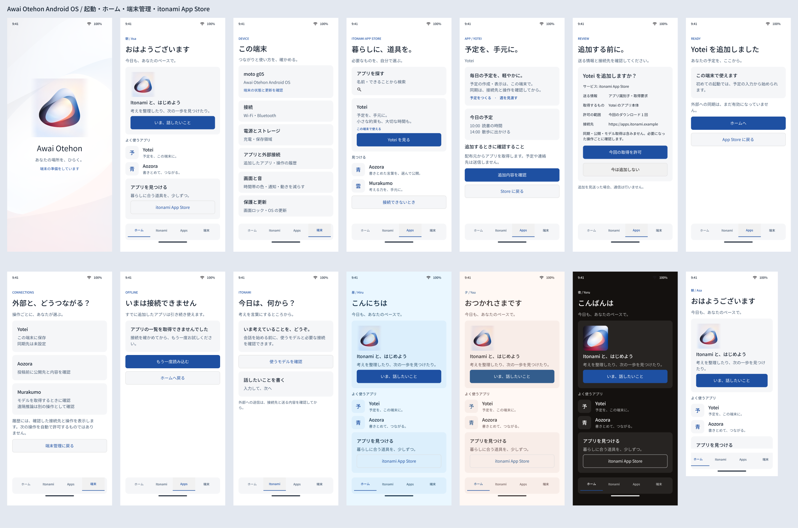

# Awai Otehon Android OS — Figma design

2026-11-16 · [AWAI-2974](https://linear.app/kotobalabs/issue/AWAI-2974) · child of AWAI-537.

[Editable Android page](https://www.figma.com/design/umqCqP5KSjLWh9fhCI1HaN?node-id=182-2) · [Overview](https://www.figma.com/design/umqCqP5KSjLWh9fhCI1HaN?node-id=184-293) · [Prototype from boot](https://www.figma.com/proto/umqCqP5KSjLWh9fhCI1HaN?node-id=183-1073&starting-point-node-id=183%3A1073)

## Delivered

14 editable top-level phone frames on new page `Awai OS · Android · AWAI-2974`. Existing pages, shared component sources and shared variable values were preserved.

| ID | Screen | Figma node |
| --- | --- | --- |
| A00 | Boot | 183:1073 |
| A01 | Home / Asa | 183:1102 |
| A02 | Device management | 183:1152 |
| A03 | itonami App Store | 183:1192 |
| A04 | Yotei detail | 183:1239 |
| A05 | Scoped download confirmation | 183:1273 |
| A06 | Addition complete | 183:1316 |
| A07 | Apps and external connections | 183:1345 |
| A08 | Store offline / retry | 183:1378 |
| A09 | Itonami entry | 183:1406 |
| A10 | Home / Hiru | 183:1436 |
| A11 | Home / Yuu | 183:1486 |
| A12 | Home / Yoru | 183:1536 |
| A13 | Compact home with scroll viewport | 186:448 |

Base viewport 411×917 dp derives from connected moto g05's 720×1604 px / density280. Compact screen is 360×802 with a 320×630 scroll viewport and 741 dp content. Full body text remains 16 dp rather than scaling a screenshot.

Reused actual Awai artwork, Noto Sans JP, local Button / BottomNav and shared Daylight color modes. Added local reusable app-row component 184:228 and Android adaptation of ConsentCard 185:450. Rows, text, controls and layout remain editable. Material icons were imported from the available Material 3 library. No flattened UI screenshots were imported.

Representative routes connect boot, home, Itonami, device management, external connections, Store, Yotei detail, review, decline, complete and offline retry. Two starting flows: boot and home. 68 descendant prototype sources were structurally observed before adding the compact clone; this is not a claim that every presented control has implemented behavior.

## Interaction and implementation boundary

- Boot copy follows real preparation stages; no fabricated progress percentage or completion ETA. Suggested 350 ms calm fade; reduced-motion setting uses immediate transition. Prototype click-to-continue is a review convenience.
- App acquisition is one fresh operation. Show service, endpoint, data categories, artifact and one-operation scope before approval. Decline sends nothing.
- Sync, publication, model download and remote inference require separate confirmations. The download confirmation grants none of those.
- `apps.itonami.example` is a reserved illustrative domain. No live catalog, artifact version, digest, identity or signed release was verified by this design. Production implementation must pin source/version and verify independently available digest/signature before presenting completion.
- Example schedules, battery status, device cards and completion states are design fixtures, not runtime measurements. Figma does not execute requests, install apps or persist permissions.
- Device management provides information architecture. Individual Wi-Fi/power/appearance/security settings subflows and actual Android permission dialogs remain implementation work.
- The Itonami conversation/model selection entry is illustrative; model selection, text input and inference are not functional here.
- Android/LineageOS is the design basis. No NixOS device boot or Awai launcher installation is claimed.

## Verification

Inspected native node structure and all screen bounds. Main-screen content bottoms are ≤789 dp, above navigation at807 dp. Corrected consent wrapping, leftover desktop copy and active navigation variants. Compact content intentionally clips within its scroll viewport. Font inventory is Noto Sans JP only. Inspected whole-composition screenshot after corrections; no observed main content/navigation overlap. Night text links and app marks were made lighter and original logo retained visibly.

Visual QA is a design review, not Android accessibility/runtime qualification: notch/insets, IME, large font settings, TalkBack, live network error handling and physical touch/navigation remain to verify during implementation. No automated application tests apply to this Figma-only change.

## Run and measurement

- Explicit issue/run binding: AWAI-2974 / a9cab5e5-bf7f-4670-a9dd-08cd9c9cf381; Codex chat01a1e187-0e12-7813-b500-73aa77f2a03e; task branch codex/awai-2974-android-figma-20261116; base4222319.
- Issue created07:19:00.769Z; visual verification completed07:42:32Z. This window includes discovery and mixed physical-install closeout; it is not active design time.
- Planned/logged model from local session context: OpenAI environment, gpt-6.1-sol / medium. Billing identity and current provider-wide coverage unknown.
- Configured Linear estimate/unit, calibrated token forecast, issue-attributable input/cache/output/reasoning/cache-write tokens, cost and active/wait split: unknown. Mixed discovery/physical-closeout overhead remains unallocated, not silently assigned to either issue.
- Verified deliverable: one editable Android screen set plus structural/visual QA and prototype route structure. No completed-unit velocity is calculated from status or elapsed time.
- Current Figma artifact is delivered; repository PR records the design handoff only. Android implementation, device deployment and user acceptance are separate outcomes.

Task worktree and .agent-output are preserved: unique design evidence and an open reporting PR prevent collection. No unrelated worktree, branch or stash was changed.

