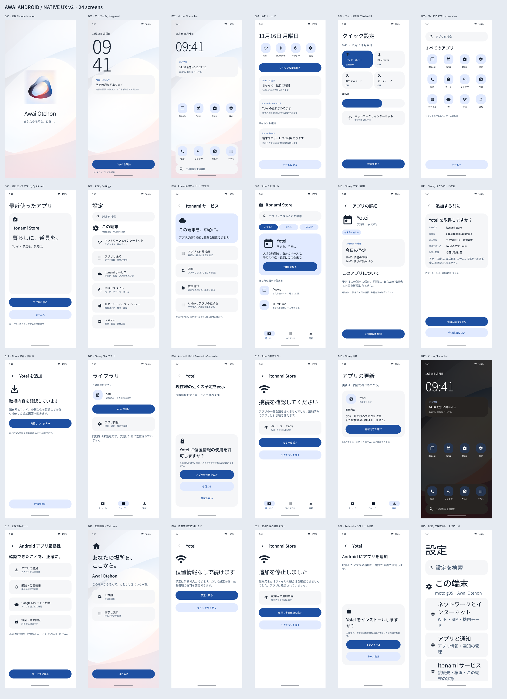
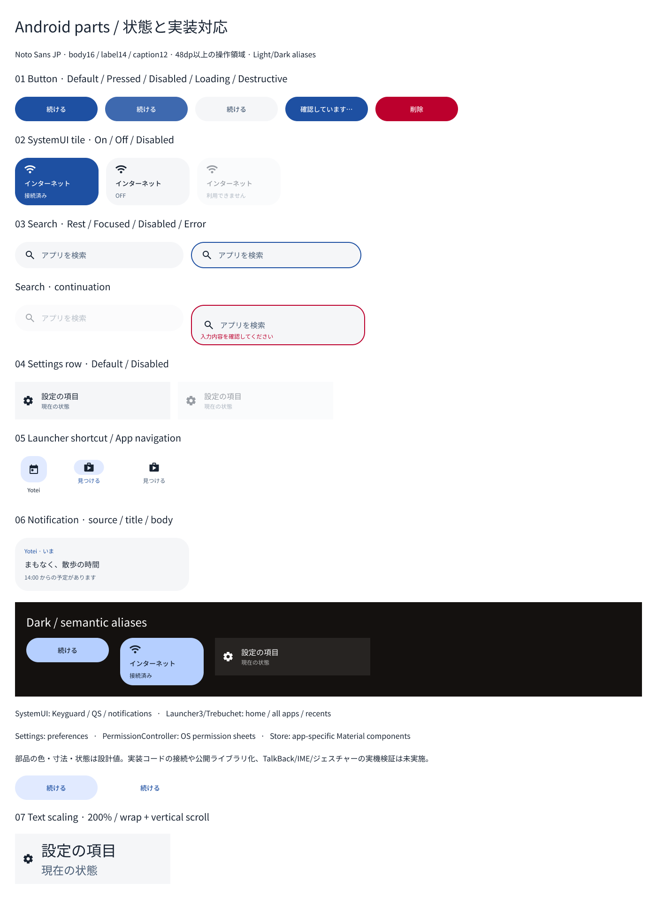

# Awai Android Native UX v2 — design and implementation references

2026-11-16 · [AWAI-2984](https://linear.app/kotobalabs/issue/AWAI-2984)

[Editable v2 page](https://www.figma.com/design/umqCqP5KSjLWh9fhCI1HaN?node-id=192-2) · [24-screen overview](https://www.figma.com/design/umqCqP5KSjLWh9fhCI1HaN?node-id=197-735) · [parts and states](https://www.figma.com/design/umqCqP5KSjLWh9fhCI1HaN?node-id=197-607) · [implementation map](https://www.figma.com/design/umqCqP5KSjLWh9fhCI1HaN?node-id=205-1457) · [prototype from home](https://www.figma.com/proto/umqCqP5KSjLWh9fhCI1HaN?node-id=194-2439&starting-point-node-id=194%3A2439)

## Why v2

Jun identified low UI/UX maturity in v1 and requested redesign plus reference sites for Android AOSP/LineageOS implementation. V1 used essentially one card-and-bottom-navigation layout across unlike OS surfaces. V2 separates Android system navigation, Launcher shortcuts, hierarchical Settings and Store-specific app navigation. Existing Page1, v1 and all other pages/source variables remain preserved.

This is a design proposal and editable implementation handoff. It is not a port, installed launcher, SystemUI replacement, Google certification or finished GMS service.

## Surfaces

| ID | Surface | Node |
| --- | --- | --- |
| B00 | 起動 / bootanimation | 194:2398 |
| B01 | ロック画面 / Keyguard | 194:2417 |
| B02 | ホーム / Launcher | 194:2439 |
| B03 | 通知シェード | 194:2532 |
| B04 | クイック設定 / SystemUI | 194:2597 |
| B05 | すべてのアプリ / Launcher | 194:2659 |
| B06 | 最近使ったアプリ / Quickstep | 194:2787 |
| B07 | 設定 / Settings | 194:2815 |
| B08 | Itonami GMS / サービス管理 | 194:2894 |
| B09 | Store / 見つける | 194:2956 |
| B10 | Store / アプリ詳細 | 194:3049 |
| B11 | Store / ダウンロード確認 | 194:3085 |
| B12 | Store / 取得・検証中 | 194:3128 |
| B13 | Store / ライブラリ | 194:3158 |
| B14 | Android 権限 / PermissionController | 194:3222 |
| B15 | Store / 接続エラー | 194:3258 |
| B16 | Store / 更新 | 194:3322 |
| B17 | ホーム / Launcher | 194:3380 |
| B18 | 互換性レポート | 194:3473 |
| B19 | 初期設定 / Welcome | 194:3533 |
| B20 | 位置情報を許可しない | 198:1316 |
| B21 | 取得内容の検証エラー | 198:1371 |
| B22 | Android インストール確認 | 198:1425 |
| B23 | 設定 / 文字200%・スクロール | 199:1310 |

The frame is411×917dp, based on previously measured g05 density. Top status area, app bar/content, app-local navigation and bottom Android gesture handle have separate ownership. Startup has no fake SystemUI status/gesture bar. Device-specific cutout/insets remain to measure during actual implementation.

Home uses editable original Awai artwork, a glance widget, four app shortcuts, separate dock/search and Android gestures. The lockscreen redacts sensitive notification text; the prototype skips OS authentication. Notification shade/Quick Settings/all apps/recent tasks are separate surfaces. Store approval, acquisition/verification, Android installer and later runtime permissions are separate transitions.

## Reusable parts

| Family | States / properties | Node |
| --- | --- | --- |
| Button | Primary: Default/Pressed/Disabled/Loading/Destructive; default Tonal/Text; Label | 193:263 |
| Quick Setting | On/Off/Disabled; label/status/icon swap | 193:282 |
| Settings row | Default/Disabled100%; Default200%; title/summary/icon swap | 193:302 |
| Search | Rest/Focused/Disabled/Error100%; Rest200%; placeholder and error message | 193:325 |
| Launcher shortcut | app label/icon swap; adaptive container | 193:344 |
| App nav item | Selected/Unselected; app-scoped label/icon | 193:354 |
| Notification | source/title/body; redaction use | 193:369 |

22 variants/single parts across7 families, plus18 icon components. Component source construction remains outside review frames. Actual Material3 components/icons and Google's material-design-icons SVGs were used where compatible; no flattened UI screenshot is an input. Noto Sans JP is the only font. Shared text styles/body16/label14/caption12 are reused; clock/large-text examples intentionally override type size.

Existing palette/spacing foundations are reused through aliases, with new Android shape20/28, 48dp target and icon-tone semantics. New token collections have explicit scopes and proposed Web/Android code syntax; these token names do **not** establish existing Kotlin/CSS or Code Connect integration. No native Android component implementation was discovered in this repository; implementation mapping is a handoff.

Button review instances are176×52dp; shortcut targets80×96dp, app nav items121×72dp, search56dp and preference rows at least80dp. System edge gestures are distinct from buttons. Disabled parts are informative states, not enabled actions.

## Behavior and states

- Boot → lock → OS authentication → home. Figma omits authentication and uses a review click to progress.
- Home top edge drag → notifications; notification drag → Quick Settings; home background drag → app drawer; bottom-edge drag → recents. These prototype triggers approximate routes, not Android gesture physics/direction/velocity/back behavior.
- Store detail → fresh scoped acquisition review → fetching/verification → successful verification → Android installer → library.
- Verification failureB21 stops addition. Retry returns to a fresh review; no silent alternate distribution source. OfflineB15 preserves access to installed apps.
- Runtime location permission denialB20 permits manual calendar use. Download consent does not grant Android runtime permissions or future external sync/inference.
- Initial source screens include synthetic data. Schedules, updates, network/service state, installer success and notification contents are fixtures. `apps.itonami.example` is a reserved illustrative endpoint. The prototype performs no real permission, network, payment, authentication or installation operation.
- Integrity mismatch, denial and large-text examples have independent prototype starting points. Outcomes are specified by the implementation map; there is no real conditional backend in Figma.

## Official references and implementation ownership

| Need | Reference | Use |
| --- | --- | --- |
| UI design foundation and Figma kit hub | [Material3](https://m3.material.io/) | color/type/shape/motion/components; available Material3 Design Kit was searched in the target Figma file |
| Android UX patterns | [Android Design](https://developer.android.com/design/ui/mobile) | mobile layout, system interactions, widgets and patterns |
| Application widgets | [Compose components](https://developer.android.com/develop/ui/compose/components) | Store/app UI implementation; not a wholesale SystemUI replacement |
| Icon parts | [Material Symbols](https://fonts.google.com/icons), [source icons](https://github.com/google/material-design-icons) | shipped icon sources rather than drawn approximations |
| Status/navigation/insets | [Android system bars](https://developer.android.com/design/ui/mobile/guides/foundations/system-bars) | WindowInsets, edge-to-edge, cutouts and Android gestures |
| Touch/accessibility | [Compose accessibility defaults](https://developer.android.com/develop/ui/compose/accessibility/api-defaults) | 48dp targets and semantic role behavior |
| Notifications/QS/keyguard | [AOSP SystemUI](https://android.googlesource.com/platform/frameworks/base/+/refs/heads/main/packages/SystemUI/) | OS implementation layer |
| Home/all apps/recents | [AOSP Launcher3/Quickstep](https://android.googlesource.com/platform/packages/apps/Launcher3/+/refs/heads/main/), [Lineage Trebuchet](https://github.com/LineageOS/android_packages_apps_Trebuchet) | launcher and gesture/task integration |
| Settings preferences | [Lineage Settings](https://github.com/LineageOS/android_packages_apps_Settings) | settings hierarchy and preference implementation |
| Runtime permissions/installer integration | [AOSP PermissionController](https://android.googlesource.com/platform/packages/modules/Permission/+/refs/heads/main/PermissionController/) | privileged OS flow, not a web dialog grant |
| Resource theming | [AOSP RRO](https://source.android.com/docs/core/runtime/rros) | existing overlayable resources; cannot replace arbitrary control code |

Checked2026-11-16. These upstream references are navigation starting points; implementation must pin the exact manifest/revisions matching Lineage24/Android17 on g05. The direct Figma Community kit page could not be fetched by the web reader, so no fetched-content verification of that page is claimed; the available Material3 library was verified through Figma MCP. One site does not contain every OS implementation part.

## Verification and remaining qualification

Native editable node/text/instance structure and prototype reactions were inspected. Major normal-screen content bounds fit above their app/system navigation; Store content ends702dp vs app-nav807dp. B23 has1295dp content in an808dp vertical scroll viewport; 200% row text is32/24dp and search32dp. The review control bounds and one normal-scale large-text screenshot were inspected. Whole-composition and parts screenshots were checked after repairing transparent icon bounding paths, clone property bindings, action labels, selected navigation, disabled/loading sizing and large-type wrapping.

Calculated semantic text contrast:

| Pair | Light | Dark |
| --- | ---: | ---: |
| text / background |15.85|18.80|
| muted / background |6.87|9.45|
| onPrimary / primary |7.71|10.06|
| onContainer / container |13.14|12.34|
| primary / background |7.71|11.94|

These calculations cover the selected semantic color pairs, not every image pixel, disabled control, icon overlay or accessibility use case. Real Android TalkBack, focus order, IME, notch/insets, predictive back,3-button navigation, rotations, long/localized app names, tablet/foldable sizes and hardware gesture behavior remain unverified. The clock/daylight/wallpaper design is not an Android boot animation asset bundle.

## Tracking and source state

Binding: AWAI-2984/9513bf53-a01a-444d-b124-2b187c78cdd4; chat01a1e187-0e12-7813-b500-73aa77f2a03e; branch codex/awai-2984-android-ux-v2-20261116; base4222319. Session-context model gpt-6.1-sol/medium; issue-attributed actual model/token counters, estimate/unit, calibrated forecast, cost and active/wait breakdown unknown. No velocity or maturity percentage is invented.

AWAI-2974 retains v1; this follow-up covers the owner's specific native UX revision. GMS/Store engineering remains in AWAI-2975 and AWAI-2976/PR146, separate from Figma delivery. Its exact-head core/module/package CI passed at3a0e46a; broader deployment/adapter/runtime work remains open. No phone, account or live service was changed by v2.

This reporting-only PR preserves design evidence. Worktree/.agent-output are retained because the report PR and unique design QA evidence are open; no unrelated worktree/branch/stash cleanup was performed.

