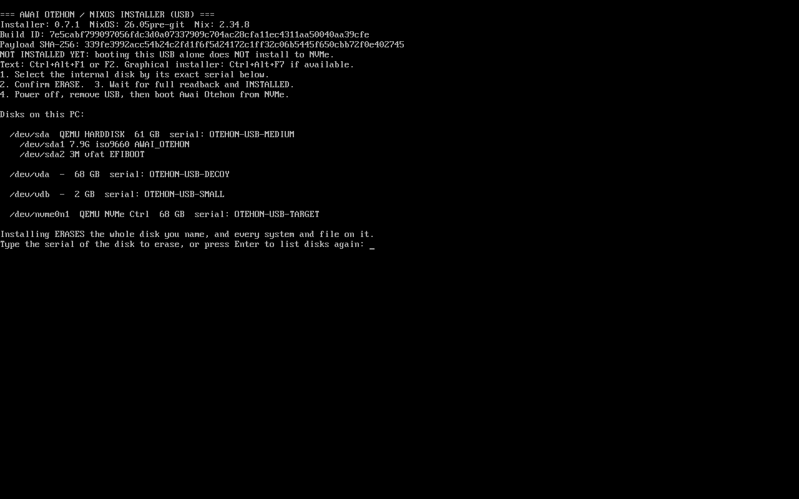
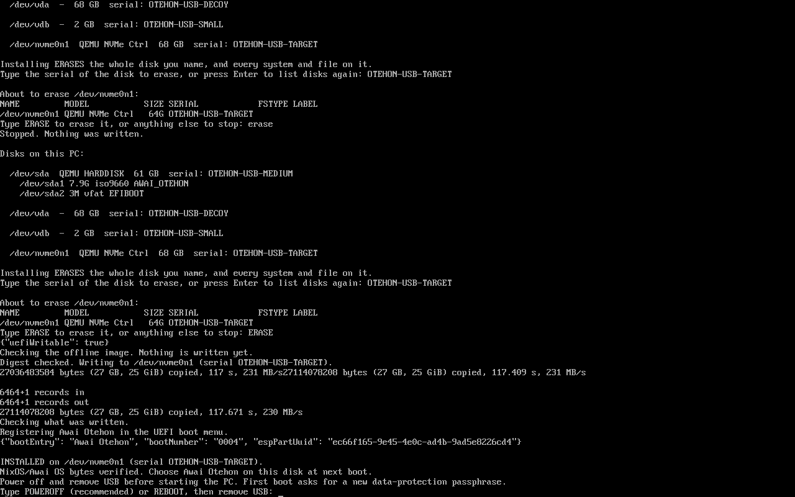

# Awai Otehon 0.7.2 を USB から NVMe に導入する

0.7.2 は日本語の文字版ディスク選択を備えた更新候補です。配布時には版・Build ID と同一 ISO の VM/USB 証跡を別途対応させます。

## GUI が出ないとき

1. UEFI の起動メニューで KIOXIA USB を選びます。
2. Awai の起動メニューで `Text-installer-0.7.2` を選びます。通常起動後は Ctrl+Alt+F1/F2 でも文字版へ移れます。
3. 画面の版・Build IDを上の配布記録と比較します。オフライン画面は最新版を自動照会しません。
4. ディスク一覧で内蔵 NVMe の型番・容量・現在の領域を確認し、左の番号を入力します。シリアル番号の手入力は不要です。
5. 別画面に表示された保存先を再確認し、上書きしてよければ `1. すべて消去してインストール` を選びます。既存OS・ファイルは削除されます。`0` で戻れば書き込みません。
6. 「インストールが完了しました」が出るまで電源とUSBを保持します。書込み終了だけでは完了ではありません。
7. `1. 電源を切る` を選び、停止後にUSBを抜き、PCを起動します。UEFIで `Awai Otehon` を選びます。

完了画面の `2. 再起動` も選べます。起動USB・使用中・容量不足などのディスクは選択できません。

以下は 0.7.1 の旧画面です（0.7.2 の受入証跡ではありません）:

0.7.1 の旧完了画面:

## GUI で導入するとき

「このPCにAwaiをインストール」→保存先→シリアルと `ERASE` →実行、の順です。
処理は配布データ確認、NVMe書込み、全長読み戻し照合、UEFI起動登録です。
「インストールが完了しました」と導入先・起動登録を確認してから電源を切り、USBを外します。

USBから起動しただけでは内蔵ディスクへ導入されません。右上の「USBから起動中」は現在の起動元であり、NVMeの導入完了は完了表示で確認します。

## NVMe からの初回起動

データ保護のパスフレーズをPC上で設定します。次回起動時は同じパスフレーズで解除します。値をチャットへ送る必要はありません。

失敗表示・診断コードが出た場合は導入完了として扱わず、版・Build ID・保存先の型番/容量と最後の画面を記録してください。
書込み開始後の失敗では選択先が変更されている可能性があります。

## 検証範囲

0.7.2 は同一 ISO の GUI/GUI無効の日本語文字版で、番号選択、拒否/戻る、NVMe導入、全長照合、UEFI登録、USBなし起動、暗号化状態の初期設定、冷再起動と解除を検証してから配布します。
0.7.1 の受入は[以前の配布記録](usb-installer-0.7.1.md)に保持しています。
実6600HのGPU/firmware/内蔵媒体、実電源断、Secure Boot、本番ネット更新のenrollmentは別の受入です。

[0.7.0の履歴](usb-installer-0.7.0.md) / [Figma](installer-ux-figma-20261114.md)
