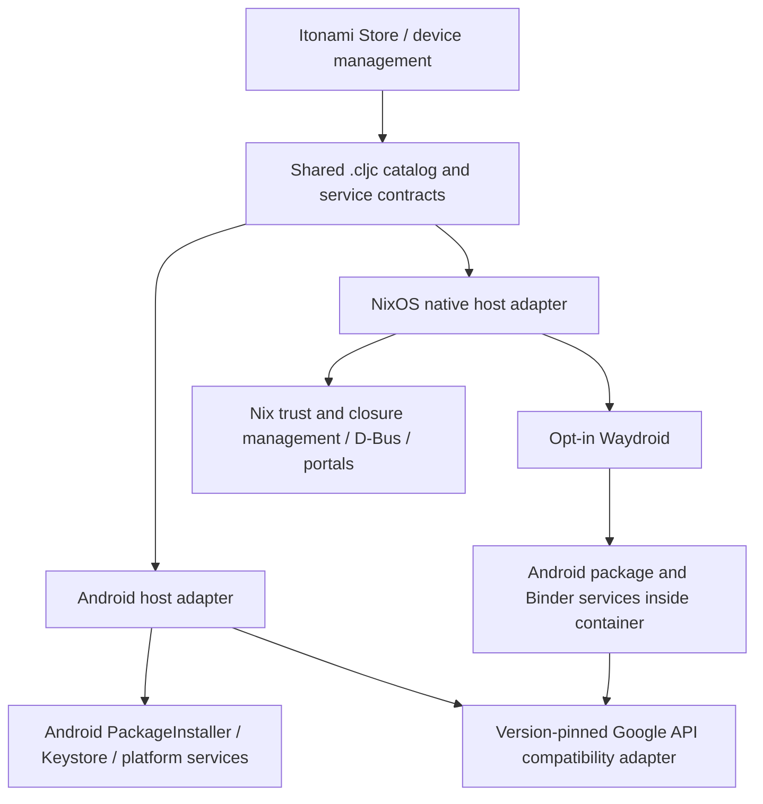

# Itonami GMS: shared Store and cross-platform services

2026-11-16 · [AWAI-2975](https://linear.app/kotobalabs/issue/AWAI-2975)

Owner direction: build **Itonami Store as the Android/NixOS common foundation**, while improving Google Play-distributed app runtime compatibility in parallel. Optional Google Play Store client/account/purchased-app support is a later, separately qualified track.

## Architecture

Itonami identity/notifications/location/sync and store metadata use a shared contract, with platform-specific privileges and storage. Android Google package/Binder interfaces remain Android-specific, including inside Waydroid. NixOS-native software uses Itonami APIs directly; it does not pretend to be Android or load an APK natively. microG is a candidate compatibility component, not a new name for the whole Itonami service layer and not an automatic substitution for the Google backend.

Browser operations stay in the user's environment and use the canonical Kotoba client-runtime broker. Origin hosting remains static. Native host services belong to a distinct platform layer, with authenticated calling-app identity, least privilege and explicit operations; they do not create an app-origin BFF or inherit browser permissions. No user data or credentials go into compatibility telemetry.

## Delivery sequence and acceptance

| Track | Linear | Acceptance / dependency |
| --- | --- | --- |
| P0 shared core / packaging | [AWAI-2976](https://linear.app/kotobalabs/issue/AWAI-2976) | Executable selection, offline digest check, evidence scoping tests; Nix eval/package validation separate |
| P1 common Store | [AWAI-2977](https://linear.app/kotobalabs/issue/AWAI-2977) | Signed metadata, publisher rotation/revocation, broker-based fetch, platform installation handoff, offline/update flows; after P0 |
| P2 Android compatibility | [AWAI-2978](https://linear.app/kotobalabs/issue/AWAI-2978) | Read-only ROM inventory, pinned microG evaluation, scoped package/signature behavior, g05 API tests; parallel to P1 after contract |
| P3 NixOS / Waydroid | [AWAI-2979](https://linear.app/kotobalabs/issue/AWAI-2979) | Native service adapters plus optional isolated Android container; VM then physical ABI/GPU/network/input tests |
| P4 common services | [AWAI-2980](https://linear.app/kotobalabs/issue/AWAI-2980) | Identity handles, notification lifecycle, location permissions and selected sync; native Android/NixOS adapters, restart/revocation tests |
| P5 compatibility matrix | [AWAI-2981](https://linear.app/kotobalabs/issue/AWAI-2981) | Exact app/build/API/environment cases; no unknown-to-pass promotion; runtime evidence depends on P2/P3 |
| P6 staged release | [AWAI-2982](https://linear.app/kotobalabs/issue/AWAI-2982) | Publisher/APK/Nix/OS trust boundaries, update recovery, physical acceptance and explicit release rollout |

Reuse AWAI-2974's editable Store screens and AWAI-2967's functioning g05 LineageOS base. Neither proves GMS/API compatibility. Existing identity/store/runtime work must be linked rather than duplicated when implementing adapters. No phone reflash, package replacement, account login, purchase or production cutover occurred in P0.

## Compatibility dimensions

| Dimension | Android g05 | NixOS-native | NixOS + Waydroid |
| --- | --- | --- | --- |
| Itonami shared Store contract | P0 source | P0 source | P0 selection only |
| Host installer / signed release | unqualified | unqualified | unqualified |
| Android SDK/NDK apps | qualify per app/build | requires Android runtime | qualify per image/ABI/app |
| Google push/location/maps/sign-in APIs | microG candidate, untested | own Itonami APIs, no Binder equivalence | Android compatibility candidate, untested |
| Google account / Play Store acquisition | separate optional track | no native Play client claim | separate optional track |
| Billing / purchased license / DRM / Integrity | unknown per app and backend | no equivalence claim | unknown per app and backend |

Fix a representative test denominator before reporting rates. Each case records exact app/version/hash, OS build, ABI, adapter/source version, acquisition path, step and independent evidence/time. Installation, launch, push receipt, location precision, maps, authentication, upgrades, billing, licensing, DRM and integrity are independent outcomes. Imported reports are not authenticated by P0; stale results are not portable across version changes. No bank/paid-app testing or account access is inferred from this plan.

An Android-compatible build requires the relevant CDD/CTS. GMS/Play Store licensing is a separate consideration. API signature-spoof support needed by microG does not establish hardware-backed device integrity or Google certification. Play Integrity combines request, application, account and device verdicts; do not forge or report successful verdicts without actual verified results.

## P0 implementation and evidence

Source: `otehon/itonami-gms`. Shared pure `.cljc` selector/reporting core, offline Babashka CLI, opt-in Nix module and two Nix check expressions. Local7 tests/54 assertions passed on Babashka1.12.218 (initial test syntax errors corrected before passing). CLI contract smoke passed. No app catalog is shipped: bootstrap metadata is empty and expired. SHA-256 match authenticates bytes against a supplied value only; catalog signatures, secure fetching, installer and API adapters are still absent. Do not advertise this as a usable Store/GMS release.

Nix binary unavailable locally: package/module evaluation and VM checks are **unverified**, not passed. No Android/Waydroid build or hardware GMS test performed. No CI has been changed to add Java/Gradle; check the Otehon toolchain boundary before adding Android adapter build gates. Current Otehon `.cljc`/Babashka implementation remains in its permitted profile, separate from Native.

Run binding: AWAI-2976/5068047b-a8b1-4ca2-b8fd-c337097c32d8; parent AWAI-2975 is a rollup, not an additional usage allocation. Chat01a1e187-0e12-7813-b500-73aa77f2a03e; branch codex/awai-2975-itonami-gms-20261116; base4222319. Local context model gpt-6.1-sol/medium, OpenAI environment; estimate unit, calibrated token forecast, attributable token counters/cost, exact active/wait and provider billing coverage unknown. Do not run the earlier physical-install allocation script on this mixed session. No percent complete, ETA or velocity is inferred from issue count.

## Primary sources checked 2026-11-16

- [Google Play services runtime/client architecture](https://developers.google.com/android/guides/overview)
- [AOSP Android compatibility and GMS licensing distinction](https://source.android.com/docs/compatibility/overview)
- [microG GmsCore upstream](https://github.com/microg/GmsCore), [prerequisites](https://github.com/microg/GmsCore/wiki/Prerequisites), [signature support](https://github.com/microg/GmsCore/wiki/Signature-Spoofing), [license](https://github.com/microg/GmsCore/blob/master/LICENSE). Pinned source/license/SBOM audit remains P2, no upstream code bundled here.
- [Waydroid APK installation and ABI limits](https://docs.waydro.id/usage/install-and-run-android-applications)
- [Google Play Integrity verdict meanings](https://developer.android.com/google/play/integrity/verdicts)

These moving documentation pages support the design rationale, not pinned executable artifacts or a device compatibility result.
